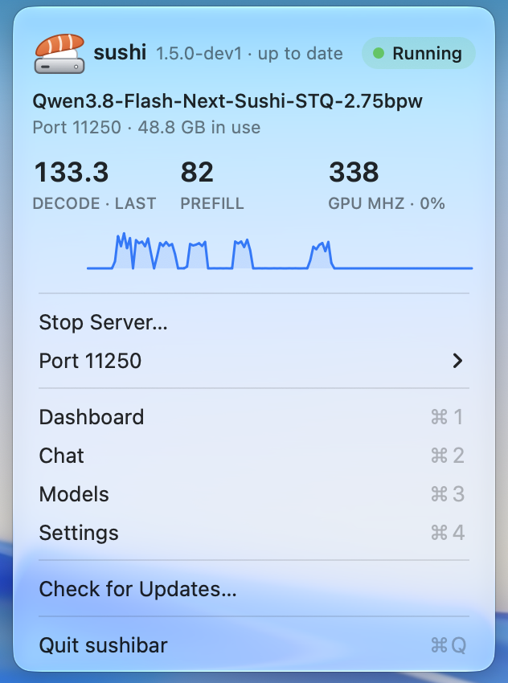
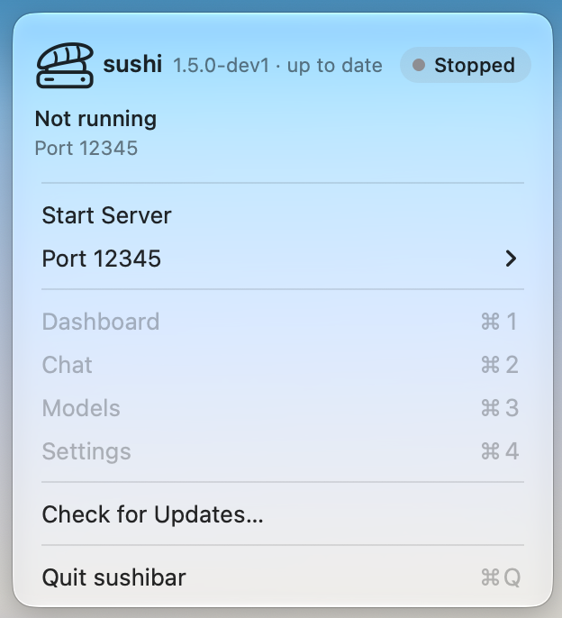

# Changelog

sushi began as a fork of [mlx-serve](https://github.com/ddalcu/mlx-serve) and was detached from it on 2026-09-17 at
mlx-serve commit `ef5e667` (two commits after mlx-serve v26.9.4). This file covers sushi's own changes since then;
earlier history is mlx-serve's, in that project's changelog.

## Unreleased

- **A stream with no tools declared holds a thought that writes call markup until the reply ends**: the whole reply reads such a thought's close by the call's own value end, which a later byte can flip, so its reasoning after the call and the answer after `</think>` arrive at the reply's end instead of as they come.
- **The debug log no longer reports a tool call as dropped while the model is still writing it**: a stream's keepalive re-read the growing call and wrote "tool markup parsed to no call" for each read (22 lines in one Claude Code run, every call delivered). Only the final read writes the line now, and it names the cut call's own start, its length and the calls parsed before it.
- **Current Codex runs on sushi again**: `/v1/responses` serves a `namespace` tool (Codex's `multi_agent_v1`) by offering its member functions to the model and returning a call to one with its `namespace`, a malformed namespace is a 400 naming it, a hosted `web_search` is a 400 naming the tool and Codex's `web_search = "disabled"` setting, and `sushi launch codex` writes that setting.
- **A thought that holds a call with a mangled quote splits the same on a stream as on the whole reply**: `plan <tool_call>{"name":"f","arguments":{"k":"v}}</tool_call> done</think>answer "q` read the thought's close while it streamed and lost it when the answer's own quote arrived; a call's end is now judged from the bytes before its closer, never from a quote after it.
- **A JSON or Gemma call whose string spells braces that close the object right before a closer now ends there**: `{"k":"}}</tool_call> y"}}` was read as one call to its last closer because a quote followed; the bytes before a closer cannot tell `}}` in a string from a dropped quote, so the call ends at the first closer, as it does for `{"k":"v}}` (cell `r174-f-closer-monotone`).
- **`sushi launch aider` is gone**: aider is not an agent sushi supports, so the launcher now refuses it as an unknown agent and no longer writes `~/.sushi/aider/`.
- **The `[admission]` line names the decoder-pool bytes a DeepSeek prefill borrows**: `lendable` sits beside `needed`, so a resident prefill's hold, which is more than `needed` by design, can be checked against `needed + lendable` from the log.
- **A DeepSeek-V4.1 row store whose grow fails inside MLX no longer keeps a part at a size its capacity disagrees with**: the codes grew before the scales, so a failure at the scales (or at a trim after a truncate) left the codes at the new size and the capacity at the old one, which under-billed the store or let a later append write past the codes' end; every part is now built before any old one is freed.
- **A thought with one stray backtick before its close is no longer swallowed whole**: `<think>use the ` key</think>answer` returned its whole text as reasoning and an empty answer, because the lone backtick opened a code span to the end of the line; a span now opens only where its closing backtick follows on the line, on every surface, stream or not.
- **Logprobs list exactly the tokens a reply's content came from**: a constrained reply listed the tokens its bytes were first found at (a thought holding the same text listed the thought), a token with a think closer inside it listed twice, and a Gemma thought opened after content streamed the word `thought` as content.
- **A request's memory bill is its larger phase, not the sum of both**: the bill added the decode step's cache regrow to the prefill chunk's transient, which are never held together, so a request whose prefill dominates was billed up to 0.5 GB (MiMo, its sliding rings) more than it holds, and the context Sushi advertises and the refusals that name a context or `max_tokens` follow the lower bill.
- **A decode step's dense KV rebuild is now billed**: no bill carried the bytes a decode step rebuilds its packed KV cache into, so a long reply on Sushi Cooler with the packed attention arms off, where a decode step rebuilds the whole cache, was under-billed by up to 2.0 GB (Flash-Next at 786,432 keys); the decode phase now prices that rebuild the way the prefill phase does.

## v1.7.3 — Claude Code and tool calls that hold, requests checked end to end

Bugs fixed in this release, by severity and area:

| Severity | Memory & admission | Server & API | Models & loads | Engine & tests | Total |
|---|---|---|---|---|---|
| High | 3 | 4 | 5 | 1 | 13 |
| Medium | 9 | 12 | 5 | 7 | 33 |
| Low | 7 | 9 | 3 | 9 | 28 |
| Total | 19 | 25 | 13 | 17 | 74 |

- **Claude Code sessions run again, and long tool calls keep streams alive**: `/v1/messages` takes a `system`
  message inside `messages` again and reads it into the prompt where it sits, as 1.7.1 did
  ([#115](https://github.com/beamivalice/sushi/issues/115)). While the model writes a long tool call, every surface
  now sends the call's opening and an empty arguments event every 5 s, so clients whose idle watchdog counts events
  (not keepalive comments) no longer give up and retry mid-call.
- **Every request field is checked and read from one table, per surface**: a field a surface would have dropped, or
  one of the wrong shape, is a 400 naming it, where it was silently ignored (a `top_k` of 2.5 is refused, not served
  as 2; a Responses `stop` is read). Newly refused: OpenAI's legacy `functions` and `function_call`, the `grammar`
  and `guided_*` constraint fields, and Messages tools of any type but `custom`. Responses now serves
  `stream_options`; Codex's `store`, `service_tier`, `safety_identifier` and `metadata` stay accepted.
- **Tool calls come out right in a dozen more shapes**: calls cut short or left open by the model's own end,
  backticked, spelling their own closer or `</think>` in a value, bare JSON after prose, and MiniCPM5, `<invoke>`,
  `<tool>` and DSML markup are each shipped as written or declined by name, never sent half-made or leaked into the
  reply's text; a reply of hundreds of calls settles in milliseconds again.
- **Memory bills match what runs**: cache regrows, KV rebuild copies, MiMo's ring compaction and DeepSeek's row
  stores are billed where they happen, so a request never holds more than it was admitted for. A resident DeepSeek
  STQ 8,192-row chunk bills 9.30 GB, not 10.78; a DeepSeek request makes its row stores at its last row (a 1M-token
  request bills 2.51 GB of state, not 2.91); with the prefix cache off no SSM checkpoints are billed; a Sushi Cooler
  refusal names a context that is then admitted.
- **Concurrent speculation holds up**: Qwen3.8-Flash-Next streams keep their grouped MTP speculation beside a
  DeepSeek-V4.1 request or a row that cannot join them, and concurrent speculative requests on Sushi Cooler no longer
  fail with `PoolOverBudget`.
- **The model list, downloads and web UI stay current**: Rescan drops a deleted or unservable model and refreshes a
  replaced one ([#114](https://github.com/beamivalice/sushi/issues/114)); a finished download shows within seconds,
  and Stop or shutdown during its last step no longer misreports or crashes; the web UI never shows an older answer
  over a newer one. `--expert-cache-bias` (0 to 2) now serves streamed Qwen STQ packs, and `sushi kld capture` always
  captures with exact routing.
- **Thanks** @catalinb13 for the debug line that names every term of a prefill's memory bill (`--log-level debug`).

---

## v1.7.2 — Memory you can count on, faster concurrent Qwen

Bugs fixed in this release, by severity and area:

| Severity | Memory & admission | Server & API | Models & loads | Engine & tests | Total |
|---|---|---|---|---|---|
| High | 21 | 10 | 2 | 2 | 35 |
| Medium | 21 | 16 | 8 | 4 | 49 |
| Low | 17 | 21 | 7 | 6 | 51 |
| Total | 59 | 47 | 17 | 12 | 135 |

- **The context sushi names is the context it admits**: requests are checked against the GPU limit macOS declares
  (`iogpu.wired_limit_mb`) less one safety margin, as in 1.6.0, not against free RAM that other apps move. A 64 GB Mac
  at the recommended limit serves Qwen3.8-Flash-Next STQ 2.75bpw at a 262K context with kv8 and images. A request that
  fits once the running ones finish now waits its turn instead of being refused, and the margin is a setting
  (`--wired-margin-gib`, Settings › GPU memory).
- **Concurrent Qwen requests are faster on Sushi Cooler**: sampled requests draft with MTP again (up to 28% more
  throughput at two rows), four joined requests read their hyper-connections in one pass (11% faster), and prefill no
  longer waits between chunks. DeepSeek-V4.1 prefills 8,192 tokens a chunk by default.
- **A thinking model never ends on an empty turn**: when a model stops inside its thought with no answer or tool call,
  sushi closes the thought and lets it continue once, on chat completions, `/v1/messages` and Responses, and says so in
  `finish_details`. On by default; turn it off in Settings › Replies or with `--no-continue-after-thought`. A client can
  also continue a reply that holds only its thought.
- **Exact memory bills**: every request reserves its cache at its last row before anything writes, the prefill's last
  forward is billed at its full width, and a DeepSeek-V4.1 prompt of a million tokens is admitted and runs. Cached
  conversations restored on the MLX engine no longer copy their cache every token.
- **Stricter, clearer APIs**: logprobs list exactly the text a reply returns; a field of the wrong type is refused by
  name; a reply cut inside a tool call never returns half a call; HTTP heads, chunked bodies and WebSocket frames follow
  the protocol to the byte; every request after a shutdown gets the shutdown error.
- **Model management you can trust**: one folder is one model however its path is spelled, `--max-resident-models` holds
  while two models load, a failed load names its own failure, and `sushi kld` without `--ssd-budget-gb` takes serve's
  memory default (fully resident on a 192 or 256 GB Mac).
- **Thanks** to @balr0g and @NikolaKrstic94 for the logs that found both memory causes, and to @yanun0323 for the
  thinking-turn report and the Strata numbers behind it.

---

## v1.7.1 — Sushi Cooler, made right: memory, refusals, long conversations

Bugs fixed in this release, by severity and area:

| Severity | Memory & admission | Refusals & UI | Server & API | Engine & tests | Total |
|---|---|---|---|---|---|
| High | 14 | 13 | 5 | 4 | 36 |
| Medium | 10 | 8 | 1 | 8 | 27 |
| Low | 7 | 2 | 2 | 8 | 19 |
| Total | 31 | 23 | 8 | 20 | 82 |

- **Every request stays inside the memory it was admitted with**: Qwen3.8's speculative requests are now billed for what
  their draft rounds hold (a short one needs up to about 560 MB more free; the advertised context does not move),
  DeepSeek counts its memory margin once, and a raised `--wired-margin-gib` applies once again, under the wired limit,
  as on 1.6.0. Leaks after a failed speculative request, after joined requests with a logit bias, and after every reload
  of an EXL3 or STQ pack are closed; concurrent and sampled requests decode together on Sushi Cooler again, and a
  failure fails only the requests it touched. Where free RAM rather than the GPU limit binds, the advertised context is
  now the one a request at that length is admitted at, so it can come out smaller.
- **Long Qwen3.8 conversations keep going**: when a turn shares the last turn's cached entry and nothing else frees
  enough room, the turn takes that entry over instead of being refused, whether it adds to the conversation, is shorter
  or regenerates the last reply (on a 32 GB Mac, a 131k-token turn that was refused is now served); turns that share
  part of an entry keep their restore points and prefill less.
- **DeepSeek-V4.1 is steadier**: a long prompt no longer re-reads decoder layers from the SSD while other requests
  decode or after a failed memory borrow, regenerating a reply reuses the conversation, a cancelled turn no longer
  costs its retry the cache (or hands it another conversation's), and an image request is no longer refused for memory
  a prompt of the same size gets. A greedy or seeded DSpark request on the release checkpoint repeats its text: on an
  M5 Ultra 256 GB with its experts streamed at `--ssd-budget-gb 200`, 26.6 tok/s decode cold and 38.6 tok/s repeated.
- **Refusals say what to do**: a request or load refused for memory names the `max_tokens`, context and SSD streaming
  memory that fit, offers streaming when a pack only fits streamed, names the Settings label beside each flag, prints
  one unit with the need rounded up and what is available rounded down, and never suggests a wired limit past the Mac's
  RAM. Sushibar shows the whole reason, the web page keeps it on screen until dismissed, every request to a refused
  model gets it, and a load the GPU limit refuses answers at once.
- **APIs and server**: errors on `/v1/messages` come in Anthropic's shape; a Responses WebSocket turn refused before it
  runs ends with an error frame, and `store: false` is echoed as sent; a client that stops reading no longer blocks an
  unload (a busy unload answers 409 within 30 s); a large SSD prompt cache
  no longer stops new connections; the web page's Thinking panel stays where you scroll it. The HTTP request-size limit
  is a setting, `server.max_request_mb` (Settings > Server, 1-1,024 MiB, 128 by default): thanks @Cianidos.
- **On the MLX route** (`--qwen-mlx-engine`, GLM-5.3-Flash, MiMo): a kv8, kv6 or kv4 cache grows on MLX's page grid, so
  its appends are never copied past the bill; a bill moves by a few MB, and on a tight Mac the advertised context can
  drop by a few hundred tokens. Sushi Cooler is unchanged by this.
- **Known issue**: DeepSeek-V4.1-Flash's FP8 release checkpoint does not load at its default SSD streaming memory on a
  256 GB Mac; set `--ssd-budget-gb 215` (the refusal names it). Thanks @nikolay-bratanov, @younesehb, @NikolaKrstic94
  and @cyrilmhansen for the reports behind this release.

---

## v1.7.0 — Sushi Cooler by default, faster DeepSeek, a lighter prompt cache

- **Qwen3.8 and DeepSeek-V4.1 run on Sushi Cooler, sushi's own Metal engine, by default**: every Qwen3.8 STQ pack and
  its BF16 checkpoint, and every DeepSeek-V4.1-Flash pack including its own release checkpoint, prefill, decode, batch
  concurrent requests and read images on it, on M1 through M5 Macs, with the tokens MLX gives. A repeat start skips the
  engine's warm-up, and nothing compiles mid-request. `--qwen-mlx-engine`, `--ds41-mlx-engine` or the model's Cooler
  checkbox keeps a model on MLX.
- **DeepSeek-V4.1-Flash is faster and steadier**: about 3% faster decode, faster long-prompt prefill, about a third less
  CPU while generating, cached turns that answer about 120 ms sooner, and agent turns that no longer re-read their
  previous reply. Sampled replies no longer slip in a random token (1.6.1-dev2 and 1.7.0-dev1), and greedy answers no
  longer depend on drafting or chunk size. On a Mac that streams its experts from the SSD, a new opt-in setting, "Faster
  SSD streaming (not exact)" in the web UI or `--expert-cache-bias`, trades a little answer quality for speed: the
  router favours an expert already in memory over a slightly better one it would read from the SSD (about 2x faster
  decode at 0.2 on a 64 GB Mac, about 30% at 0.5 on a 32 GB Mac whose cache holds far fewer experts; off by default, so
  answers stay exact). Thanks @odokododok for it.
- **A lighter prompt cache**: a Qwen3.8 conversation writes about three quarters less to the SSD (six turns on the STQ
  4bpw pack: 370 MB instead of 1,409 MB, same replies), holding its newest restore points in up to 250 MB of RAM so a
  regenerated answer restores at once, even after a restart. The SSD cache is back to full speed when saving and
  restoring, and stays within its budget on disk.
- **Less CPU, sooner answers**: about 20% less CPU over a full benchmark on Qwen3.8-Flash-Next with decode about 5%
  faster, and a 400-turn tool-calling conversation builds its prompt in 2 to 4 ms instead of up to 0.6 s.
- **Every request runs inside its memory budget**: a wide prefill no longer runs a 32 GB Mac out of memory, a 1536²
  image on Qwen3.8 takes 1.9 GB instead of 22.8 GB, and what does not fit is refused by name instead of crashing.
- **Exact prompts and tool calls on every API**: chat, Anthropic Messages and Responses render one prompt and say one
  reply; tool arguments arrive spelled as the model wrote them; GLM's forced tool calls are enforced as Qwen's are; a
  strict JSON schema is enforced as written or refused with a reason; `min_p` sampling joins every API and the chat
  page.
- **Removed: `--mtp-typical`, `--mtp-tokenv3` and `--mtp-greedy-tail`**, with their settings: speculative decoding
  accepts drafts by the exact rule only, so a seeded request repeats its text. A settings file that still names them
  loads with a warning.

---

## v1.6.0 — Stability, UI and Architecture Refactor

- **Qwen3.8-Flash-Next prefill keeps its speed on 64 GB Macs**: when macOS pushes the n-gram table out of memory beside
  the weights, prefill now keeps its parallel reads instead of walking the table from the SSD, which had halved its
  speed since 1.5.1; `QWEN4_PLE_PREFETCH_PREFILL=1` is no longer needed. Thanks @wjjchen for the report.
- **Context extension is a per-model setting**: the Models page runs Qwen3.8-Flash-Next with YaRN ×2 or ×4 over its
  native window (`yarn_factor` in `model-settings.json`), shows the resulting window before loading, and keeps separate
  prompt-cache entries per setting, so a 256 GB Mac can serve the BF16 pack or a custom pack at long context. A
  `--ctx-size` above the window is refused. Thanks @Cianidos for the request.
- **Nothing is silently clamped or ignored**: a request value out of range (`temperature`, `top_p`, `top_k`, penalties,
  `logprobs`, `seed`, a negative `max_tokens`) or a strict `json_schema` the server cannot enforce is a 400 that says
  why, and a launch flag that cannot work as given (`--mtp` with `--no-mtp`, an empty `--api-key`,
  `--max-concurrent 0`) exits with an error instead of being overridden.
- **A failure no longer outlives its cause**: a model refused for its SSD budget or memory limit loads again once the
  setting is lowered, with no restart; Load retries a failed model with the current settings; a refused Save clears when
  the value is fixed; and an SSD prompt cache declined at load (a full volume) re-attaches by itself. A model's page
  shows the Mac's three wired-memory limits with one copyable `sudo sysctl` command (thanks @Cianidos).
- **A sturdier web page**: settings are checked before they are sent, errors name their remedy instead of showing
  Offline, the chat opens on the model loaded last and follows the loaded model, a message can be edited and resent,
  each pack shows its in-memory and full weight size, the models folder is picked on the Models page, and the markdown
  renderer draws task lists, strikethrough, table alignment and bare links.
- **Fewer first-chat failures**: the first chat after loading a Flash-Next pack that streams its experts, an unloaded
  DeepSeek-V4.1-Flash missing from the chat page, a burst of reloads that loaded one model twice, and an MLX error left
  over from a load no longer fail a request; a request that fails inside the engine now logs why.
- **For hosts that vendor the engine**: each architecture is a self-contained module (`-Darchs` builds without any of
  them), `sushi_exl3` names no architecture, its deprecated aliases are gone, and its re-vendor contract is written down
  with a `version` constant. Model output is unchanged.

---

## v1.5.1 — Thinking effort settings, fuller prompt-cache reuse, faster Qwen trellis packs

- **Thinking effort is a setting**: Settings › Inference › Thinking effort sets, for Qwen, DeepSeek and GLM, which
  effort words are offered, what each one asks the model for and how many thinking tokens it may spend, from the next
  request with no reload. DeepSeek-V4.1-Flash gains real `medium` and `xhigh` levels, and Qwen set to think off stays
  off. `--reasoning-budget` is removed: use the table, or a request's own `reasoning_budget_tokens` / `budget_tokens`;
  a numeric `reasoning_effort` is now refused instead of ignored.
- **Follow-up turns reuse the whole conversation**: Qwen3.8-Flash-Next restores the previous reply on the next turn
  instead of reading it again, which halved the prompt work across our eight-category test conversations, in the RAM
  and the SSD prompt cache. A full memory cache now trims an idle session back to a restore point instead of dropping
  it, and DeepSeek-V4.1 restores an image conversation after a restart again. Thanks @cyrilmhansen for the report.
- **Faster Qwen trellis packs, and DeepSeek prefill**: Qwen3.8-Flash-Next packs with a trellis trunk decode code about
  15% faster with prompt lookup and about 6% faster overall, prefill long prompts up to 10% faster, and answer the
  first prompt after a load about twice as fast. DeepSeek-V4.1 prefills 2-3% faster, and its first long prompt after
  an update about 9% faster. Output is unchanged.
- **A clearer web page and menu bar**: the Dashboard has fourteen charts you can pick and order, which move only when
  something changes; the web page and sushibar share plain labels (Generation speed, Prompt speed, Prompt cache), and
  every chart, setting and badge explains itself in a tooltip that also names the engineering term. A page opened at
  a LAN address of a `--host 0.0.0.0` server can now load and unload models. A Cancel button stops a running request
  (thanks @chuaaron), and `/metrics` reports speculative decoding and prompt cache tiers.
  Settings gains "Skip the memory check before loading" for a Mac whose model fits but is refused (thanks @Cianidos).
- **Download packs from the web page**: Models › Available lists the published Sushi packs, recommends one for this
  Mac and downloads it with progress, Stop and Resume. A pack that is being updated, or whose update stopped half way,
  cannot load until it is complete, and Settings can turn every automatic update check off.
- **sushibar does more**: Log, Update and Quit buttons, a status card that says why a server stopped, servers bound to
  a Tailscale or LAN address, a Listen on LAN switch for the servers it starts (thanks @corysus), and a Port menu
  that keeps the ports you use. The default port is a setting.
- **MiMo-V2.6-Flash leaves the supported list**: it still loads and serves, but releases no longer test, benchmark or
  tune it; 1.5.0 was its last supported release.

---

## v1.5.0 — Menu bar, new dashboard, 10x lighter DeepSeek cache, trustworthy pack updates

- **`sushibar` puts sushi in the menu bar**: a native app beside `sushi` shows live decode speed and a status card
  (model, memory, prefill, GPU clock, a five-minute decode graph), starts and stops the server on any port, opens the
  dashboard and chat, and installs sushi updates.

  
 

- **DeepSeek-V4.1's SSD prefix cache writes about 10x less**: each context row reaches the SSD once per conversation
  instead of once per turn, so a turn's write no longer grows with the context. Over a week of long agent sessions 1.4
  wrote 120 GB to the cache, about 100 MB a turn; 1.5.0 writes about 9 MB a turn, and a 30-turn session from 72k to 176k
  tokens wrote 0.8 GB instead of 3.8 GB with the same restore after a restart. Caches from earlier versions are not
  read; clear them in Settings.
- **A new web page that opens on the Dashboard**: Dashboard, Chat, Models and Settings tabs (Cmd+1 to Cmd+4); a Compact
  view with one point per finished request and the GPU clock beside utilization; Models and Settings edit each model's
  settings and the SSD prefix cache, offering only what that model honours and naming the volume the cache writes to
  with its free space (thanks @cyrilmhansen). The page answers while a model is still loading, and metrics are on by
  default.
- **Pack updates you can trust**: `sushi pull` compares file contents instead of sizes and verifies every download, a
  pack folder that mixes two uploads is refused at load naming the file, and `sushi list`, the Models tab and `sushibar`
  say when a newer revision of your pack is published.
- **DeepSeek-V4.1 pair-major packs**: a new expert layout the streaming engine reads straight into its pools; `sushi
  repack <pack>` converts a downloaded pack in place, or `sushi pull` fetches the new revision once it is published.
  Versions before 1.5.0 refuse a pair-major pack by name.
- **Faster, steadier DeepSeek-V4.1 decode**: DSpark verifies up to seven copied tokens a round when a reply echoes its
  context (ported from CommunityServe/plugins, thanks @STRML), greedy text no longer varies between runs, decode spends
  less CPU per token, streamed experts fill faster with identical output, and `--ssd-prefetch N` makes expert prefetch
  opt-in under an SSD read cap.
- **Smaller fixes**: DeepSeek-V4.1 raw-text `/v1/completions` no longer stops at the first token, `sushi bench` no
  longer needs sudo, redirected output appends instead of overwriting, `sushi update --check` names a network failure,
  and the Models list hides test fixtures and no longer counts linked Engram shards as the pack's size.

## v1.4.1 — Faster DeepSeek prefill, DeepSeek with no flags

- **DeepSeek-V4.1 prefills up to 47% faster and decodes up to 13% faster**: on an M5 Max with the 1.75bpw pack at 128K
  tokens of code, prefill goes from 829 to 1,217 tok/s and decode from 63.7 to 72.0. The attention core runs on the
  matrix units, the shared expert rides the routed experts' launches, a prompt chunk another chunk follows skips the
  decoder tail, and the hyper-connection mix runs on a better tile; only the attention change moves output, at rounding
  level with KLD unchanged within noise.
- **DeepSeek-V4.1 runs with no flags**: a 1,000,000-token context, a 256,000-token answer budget, and an SSD budget from
  the Mac's RAM: 80 GB on a 96 GB Mac, 96 GB on a 128 GB Mac (108 GB with `iogpu.wired_limit_mb` at 120000 or more),
  fully resident on a 192 or 256 GB Mac. `--ctx-size`, `--max-tokens` and `--ssd-budget-gb` still override them.
- **DeepSeek-V4.1 needs less memory and runs on more Macs**: prefill takes about 8 GB less, the token embedding is read
  from SSD, the routers stay as stored and the image tower is half the size, all returned to the expert cache; M1 and M2
  Macs no longer abort, seeded requests repeat exactly, and a JSON schema keeps DSpark on.
- **Qwen and GLM do less work per token with byte-identical output**: fewer GPU launches per MoE layer, agent turns no
  longer prefill the previous thought again, SSD restore points every 8192 tokens up to 1M, and a reasoning budget keeps
  MTP and DSpark speculating through the answer.
- **Streams match the non-streamed answer in more cases**: `<think>` tags quoted in code and thoughts re-opened
  mid-answer stream as the non-streamed reply holds them, five more malformed tool-call shapes parse, `/v1/responses`
  keeps the model's reasoning across a tool loop, and a chat template that fails is refused by name.
- **Server additions**: `/v1/messages/count_tokens` for Claude Code, `POST /metrics/enable` and SSD-cache write metrics
  on the dashboard, a queued request says so, GIF and BMP images, idle models unload before a long prompt is refused,
  and a running stream keeps a quarter of the time while another request prefills.
- **Code for models sushi does not serve is gone**: `/v1/embeddings`, the nvfp4 quantization mode, GGUF discovery and
  unused tool-call dialects; a GGUF path is still refused by name.
- **Thanks** to @stooit for the batched-decode `!` fix (#74), @cosmic-quokka for `count_tokens`, @cyrilmhansen for the
  cache-write metrics request, and @STRML for the plugin attention work this release ports.

---

## v1.4.0 — DeepSeek-V4.1-Flash, Qwen STQ 2.75bpw, sushi bench

- **DeepSeek-V4.1-Flash on a 128 GB Mac**: the new DeepSeek-V4.1-Flash-1017-Sushi-STQ-1.75bpw pack (332 GB with its Engram tables) streams its routed experts from the SSD within `--ssd-budget-gb`, with DSpark speculative decoding, image input on by default, up to 1M tokens of context, DSML tool calls, thinking at high effort by default and `--drop-expert` to trade a few re-routed experts for memory. Greedy DSpark output is the same from run to run on the same Mac (`SUSHI_DSV41_DSPARK_EXACT=0` trades that for a plain step about 0.3 ms faster). On an M5 Max it decodes 76.6 tok/s at 4k on code and 49.3 on prose, and prefills 1,024 tok/s (sushi bench, `--ssd-budget-gb 108`).
- **Long agent sessions on DeepSeek resume where they left off**: the SSD prefix cache keeps a restore point every 8192 tokens, a follow-up turn that diverges inside the last answer rolls the live state back in place with no SSD read, a thinking turn restores from its own thought, and a request may carry up to 1024 images, of which only those the restored prefix does not hold are decoded and encoded again.
- **Qwen3.8-Flash-Next Sushi-STQ-2.75bpw** replaces Sushi-2.6bpw and Sushi-3bpw as the 64 GB recommendation (`sushi pull qwen3.8-flash-next`, KLD 0.0692 at 16x512). Qwen now thinks at medium effort by default, runs Claude-style `<function_calls>` markup as tool calls, and skips the MTP head's 1.2 GB at load under `--no-mtp`. `sushi pull` and `sushi list` use the token `hf auth login` saved, so a private pack you have access to lists with its size and pulls without `HF_TOKEN`. Thanks to [@bobosola](https://github.com/bobosola) for the report (#63).
- **Faster speculative decoding**: Qwen verifies 2 to 8 rows at an even price per row (an eight-row verify about 16% faster), DFlash2 now serves Qwen's image, video and sampled requests (about 1.7-2x plain decoding), GLM-5.3-Flash gets adaptive DFlash2 over 2 to 8 rows, and Macs without matrix units verify 3 to 8 rows up to 2x faster, all with output byte-identical to before.
- **Memory you can trust**: admission plans under the GPU memory other apps hold and counts MLX's command buffers, a Metal out-of-memory failure no longer fails the request after it, DFlash2 reserves exactly what it uses (about 2.8 GB more fits at 1M context), and DeepSeek keeps MLX's buffer pool inside its budget. Thanks to [@holistech](https://github.com/holistech) for the report (#61).
- **`sushi bench`** drives a running server through the release bench: one cold prefill in 8k restore windows up to 128k and three decode samples a rung, on a code and a prose corpus, with the GPU clock read beside every request. `frequency_penalty` now follows OpenAI's definition.
- **`sushi convert exl3 --codebook` is now `--expert-codebook`** (breaking): `--codebook mcg` becomes `--expert-codebook exl3-mcg` and `--codebook mul1` becomes `--expert-codebook exl3-mul1`; packs and resumable runs are unchanged.

## v1.3.0 — Qwen EXL3 Quantizer, Adaptive DFlash2, KV6, Dashboard

- **Qwen3.8-Flash-Next EXL3 quantizer**: `sushi convert exl3` writes a Sushi pack from the BF16 checkpoint at the rate you pick, with the trunk in the format the packs serve; runs resume where they stopped, keep finished layers and packs, and fit their Metal threadgroups to any Apple GPU. Check the result with `sushi kld`. Thanks to [@cosmic-quokka](https://github.com/cosmic-quokka) for the M2 Pro report (#57).
- **Adaptive DFlash2 for Qwen3.8-Flash-Next**: point `--drafter` at the DFlash2 drafter and Qwen verifies 2 to 8 draft rows per round as the drafter's confidence pays, up to 20% faster than MTP on Sushi-2.6bpw and level with it on Sushi-4bpw (`--drafter-min-depth` / `--drafter-max-depth`); MTP stays the default. Thanks to [@1RAFAL](https://github.com/1RAFAL) for the request (#59).
- **`--kv-quant 6` on all three models**: a 6-bit KV cache between kv4 and kv8 for Qwen, MiMo and GLM, also as `kv_quant` 6 in `model-settings.json` and per request; GLM stores its MLA latent at 6 bits and keeps DFlash2 and prefix reuse.
- **Web UI Dashboard**: a Chat | Dashboard switch in the top bar with live throughput, requests, GPU and memory charts plus sessions and models tables (needs `--metrics`); switching never interrupts a chat. Thanks to [@cosmic-quokka](https://github.com/cosmic-quokka) for the dashboard (#55).
- **Requests that used to fall back now run as asked**: MTP stays on with `presence_penalty` and `repeat_penalty`; Qwen serves `high` and `max` effort as `xhigh`, GLM serves `medium` as `high` and `xhigh` as `max`, each with a notice in the log and the response.

## v1.2.4 — Faster Qwen3.8-Flash-Next, more context admission, image cache

- **Qwen3.8-Flash-Next Sushi-2.6bpw decodes faster with the same output**: its expert kernels run about 10% faster
  per layer, about 2-4% per forward when MTP verifies drafts.
- **Twice the context on a 32 GB Mac**: Qwen3.8-Flash-Next streamed from the SSD stops billing memory it never
  uses, so Sushi-2bpw on a 32 GB Mac advertises 261k tokens instead of 140k and serves a 250k-token prompt, and a
  context that loads is one its own requests admit.
- **An interrupted `sushi pull` resumes instead of reporting the pack downloaded**: `sushi pull` now checks every file
  against the pack's listing, which also finishes a folder an earlier version left short, and `sushi list` no longer
  shows a pack as downloaded while a pull of it is unfinished.
- **Qwen3.8-Flash-Next decodes long prompts faster with the same output**: decode without MTP runs about 5% faster
  from 4k to 32k tokens of context.
- **Image conversations keep their prompt cache across a restart**: an SSD prefix-cache record now carries the images
  it was computed under, so a text -> image -> text conversation restores past its images instead of re-reading
  everything after the first one, and a changed image still invalidates only what follows it.
- **A thinking budget in the web UI**: a budget box beside the effort menu shows the chosen effort's thinking-token
  cap and takes a typed value for the request.
- **Quoted control tokens in a message no longer end the turn**: `<think>`, `</think>` or `<|im_end|>` written as text
  in a user, system or tool message (a source file Claude Code read) stays text instead of reading as a real boundary.

## v1.2.3 — Faster GLM, 32-bit Qwen GDN state

- **GLM-5.3-Flash is faster with the same output**: decode without DFlash2 runs about 9% faster and prompt processing
  about 5% faster, token for token identical to before.
- **Qwen3.8-Flash-Next forgets at its true rate**: the linear-attention decay gate and recurrent state are now f32,
  which a bf16 gate rounded to "never forget" for the slowest heads. A cached checkpoint grows by 54 MB and four-stream
  throughput drops about 2%, so `--qwen-gdn 16` keeps the bf16 state (the gate stays f32) to save memory on smaller
  Macs, and the 32 GB, 48 GB and 64 GB launch lines use it. `--qwen-gdn` now takes `32` or `16`: drop a v1.2.2
  `--qwen-gdn fp32`, which is the default now. The Qwen SSD prefix cache starts empty on the first boot after this
  change, since older entries hold a bf16 gate.
- **64 GB Macs boot the recommended context again**: the load check no longer asks for 1 GB more than the requested
  context needs, which could refuse the documented 64 GB launch (`--ctx-size 250000`) in v1.2.2.
- **GLM keeps its speed in `sushi run`**: DFlash2 now stays on for requests that carry `logit_bias` or
  `tool_choice: "none"`, which every `sushi run` turn sends, so thinking answers there decode about 40% faster.
- **Less memory per request with the SSD prefix cache**: Qwen and GLM write each prefill checkpoint to the SSD as they
  go and keep only the newest two in memory, where they held up to 16 and 9. A long Qwen request bills about 1.7 GiB
  less (0.9 GiB at `--qwen-gdn 16`) and a GLM one about 1.3 GB less, so a 48 GB Mac now reaches 200k tokens on
  Sushi-2bpw (was 160k) and a 64 GB Mac 528k on Sushi-2.6bpw (was 480k). With a RAM prefix cache beside the SSD,
  Qwen, GLM and MiMo keep only an entry's newest two restore points in RAM. Restores from the SSD give the same output,
  and a long GLM prompt sent again restores from its very end instead of re-reading its last 2k tokens.
- **Small Macs get the context they advertise**: Qwen's auto context is now the largest one its request admission
  accepts, so a prompt within the advertised context is no longer refused on a tight Mac, and the load check honors a
  raised `iogpu.wired_limit_mb` instead of refusing a model that limit fits.

---

## v1.2.2 — GLM on 96 GB, faster loads, built-in file editing

- **GLM-5.3-Flash on 96 GB Macs**: the new Sushi-2bpw pack serves GLM-5.3-Flash with DFlash2 and images on a 96 GB
  Mac, with a 512K context at 8-bit KV (300K at BF16). `sushi list` shows every Sushi pack with its size, whether this
  Mac fits it and which one to pick; `sushi pull` warns before pulling a pack that will need `--ssd-budget-gb`.
- **Faster loads**: weights load without filling the macOS file cache, so a large load no longer compresses or swaps
  the weights already in memory. GLM-5.3-Flash Sushi-2.4bpw is serving in 12 s instead of 22 s and MiMo-V2.6-Flash
  in 15 s instead of 26 s, with about 57 GB less memory compression each. Thanks @ViRb3.
- **Built-in file editing**: the chat page and `sushi run` can let the model create and edit files inside the folder
  you choose, switched per conversation with the Edit chip or `/edit on|off`; every write stays inside that folder.
  Thanks @lukadisanto for asking for it.
- **Agents and APIs**: Claude Code no longer counts cached context twice and compacts at half its real size;
  `/v1/messages` streams thinking live when tools are on; `tool_choice: "none"` stops stray tool calls; structured
  output follows `$ref`, so nested Pydantic and Zod models are enforced; a repetition loop inside a thought now ends
  the thought and lets the model answer; chat responses report their reasoning tokens; `sushi launch opencode` works
  with OpenCode builds without `--standalone`, and its `--think <effort>` is checked against what the model advertises,
  with `--persist` merging it into your OpenCode config behind a backup. Thanks @felk-dev.
- **Speed**: GLM-5.3-Flash drafts about 6% faster per DFlash2 round, EXL3 prefill no longer waits on the GPU to build
  host-side expert tables, and expert rates from 1.5 bits per weight take the fast kernels, all with identical output.
  On a slower GPU, a GLM DFlash2 commit no longer copies its whole reserved cache when it should append in place.
  Thanks @davidtai.
- **Memory and reliability**: the load check bills what each model really allocates plus 1 GiB instead of a flat
  7 GiB, and the available-memory figure no longer counts a resident model twice, so loads that fit are no longer
  refused. A stalled client is dropped after 30 seconds, model-load races are fixed, and a broken SSD cache entry is
  dropped instead of failing every later match.
- **Leaner engine**: 12% less source code, a 12% faster release build and a test build in half the time. `--help` lists every flag, and a bad value or stray argument stops before
  anything loads. `--fast`, prompt lookup decoding (`--pld*`), `--expert-cache-gb` (use `--ssd-budget-gb`),
  `--logit-bias-file`, `--embedding-max-length`, `--kv-attn-mode`, `--decode-attn-quant` and other flags with no real
  choice are gone; `--no-prefix-cache-ram` is now `--prefix-cache-mem off`. `sushi pull` downloads only from the
  `beamster` org, and over a hundred internal environment switches are removed. New: `--qwen-gdn fp32` keeps Qwen's
  recurrent state in f32.

---

## v1.2.1 — Safer prompt cache and server hardening

- **Prompt cache**: two sushi processes on the same model no longer share one SSD cache folder, which could return
  another session's answer; a restart on a nearly full disk keeps the cache, and loading a second model no longer
  deletes the first one's entries.
- **Crash fixes**: an empty `/v1/completions` prompt, deeply nested JSON and oversized WebSocket messages are refused
  with a 400 instead of stopping the server.
- **GLM-5.3-Flash**: after a client disconnects, the next request on a streamed GLM no longer fails; `sushi pull`
  now fetches the DFlash2 assistant, and deleting its BF16 source keeps DFlash2 on.
- **Tools and structured output**: earlier tool calls with empty or non-object arguments render in the model's own
  format, `anyOf`/`oneOf`/`$ref` parameters get their real types, and JSON-schema output stops cleanly on numbers and
  bounded arrays; `logit_bias: null` is accepted again.
- **CLI**: `sushi launch` quotes model names, `sushi serve` without `--model` honours the sampling flags, `update`
  no longer logs the API key, and `sushi run` accepts long pasted lines and filters terminal escapes from model output.
- **mlx-serve**: the guest manifest now lists GLM-5.3-Flash.

---

## v1.2.0 — GLM-5.3-Flash, 32 GB streaming, zero-RAM prompt cache

- **GLM-5.3-Flash**: the new Sushi-2.4bpw pack runs on 128 GB Macs (KLD 0.074 against the BF16 model) with image and
  video input, the full 1M context and DFlash2 drafting: 42–55 tok/s decode on an M5 Max. Up to four requests decode
  together.
- **Streaming with MTP**: `--ssd-budget-gb` streams any model's experts from the SSD, so Qwen3.8 Sushi-2bpw runs on a
  32 GB Mac at about 20 tok/s.
- **Prompt cache with 0 GB of RAM**: prompts are reused across turns from an SSD cache that sizes itself (up to 20 GB);
  keeping them in RAM is now opt-in with `--prefix-cache-mem`.
- **Faster**: MiMo decodes about 12% and prefills about 15% faster, Qwen3.8-Flash-Next prefills faster, and concurrent
  requests decode together on every model.
- **Agents and API**: `sushi launch grok` is new and opencode 2.x works again; streamed and non-streamed answers match
  byte for byte; penalties, `repetition_penalty` and `ignore_eos` work; GLM history renders exactly as its template.
- **Flags**: `--mtp-min-depth`/`--mtp-max-depth` replace `--mtp-depth`; new `--no-mtp-lookup` and `--gpu-warm-secs`;
  `--wired-margin-gib` defaults to 4 GiB.
- **Reliability**: long GLM sessions, memory pressure and restarts are handled cleanly, and an idle streamed server no
  longer uses CPU.

Thanks @cnsiva (request-budget defaults, `repetition_penalty`), @jasontitus (unique response IDs, the M1–M4 GLM fix,
portable GLM tests), @ShoichiTect (idle SSD-read workers) and @gomezvd (MTP on streamed Qwen).

---

## v1.1.1 — Long MiMo prompts and agent sessions

- **MiMo long prompts are admitted again**: a resident MiMo server now sizes requests against the GPU limit you set
  (`iogpu.wired_limit_mb`), not against what other apps happen to leave free, so a long agent session no longer gets
  "requires ~N MB GPU memory" on a 768k server; the prompt cache gives its memory back to a request that needs it.
- **`--prefill-chunk` is a maximum**: a request that does not fit at your chunk steps down to a narrower one instead
  of being refused. 2048 is the recommended value; wider chunks cost memory without prefilling faster.
- **Warm agent turns stop spiking memory**: a turn that reuses the cached conversation grows its KV buffers during the
  prefill, one layer at a time, instead of all at once on the first reply token, so long agent sessions stay admitted.
- **Claude Code on a local model**: `sushi launch claude` keeps each turn on one streamed request, and a request whose
  client disconnects now stops generating instead of running on for nobody.
- **Homebrew gets each release right away**: `brew upgrade sushi` sees a new version as soon as it is published.

---

## v1.1.0 — MiMo-V2.6-Flash and SSD streaming

- **MiMo-V2.6-Flash**: sushi's second model. `MiMo-V2.6-Flash-Sushi-2.3bpw` serves text and image input from one
  resident pack with native MTP, up to its full 1M-token context on a 128 GB Mac.
- **Sushi packs stream from SSD**: `--ssd-budget-gb N` keeps the trunk resident and streams the routed experts from
  SSD, so a Mac with less memory than the pack can serve it; replies are identical to a resident load. Every Sushi
  Qwen pack and MiMo-V2.6-Flash-Sushi-2.3bpw stream, and Sushi-2bpw serves on a 32 GB M1 Max at a 20 GB budget.
- **Faster Flash-Next**: on an M5 Max, Sushi-4bpw decodes 8% faster (83 -> 89 tok/s) and prefills a 10k-token prompt
  19% faster (1,796 -> 2,139 tok/s). oMLX's tensor-unit sparse attention now serves prefill from the first sparse
  chunk, GDN prefill runs a software-pipelined recurrence, batched decode overlaps GPU work with graph building, and
  `--prefill-decode-share` keeps decoders moving while a long prompt prefills. Thanks @STRML and @cowboycoderhq.
- **Better and smaller packs**: new expert weights for Sushi-4bpw (KLD 0.0632 -> 0.0592) and Sushi-3bpw
  (0.1047 -> 0.1036), and Sushi-2bpw for 48 GB Macs.
- **Live sessions on `/metrics.json`**: every in-flight request and every cached conversation, with its phase,
  context against the model's limit and the GPU memory its KV holds. Thanks @yoyo930021 and @ddalcu.
- **Updates itself**: `sushi update` installs the newest release after checking its SHA-256 and signature and keeps
  the old one for `--rollback`; a daily check, one-click update from the chat page, or `brew install
  beamivalice/tap/sushi`.
- **Fixes**: MiMo long-context memory returns to the OS, SSD prompt-cache restores keep one copy, JSON-constrained
  logprobs pair with their tokens, and a failed model load can be retried after a rescan. Thanks @brandondyal and
  @jasontitus; the EXL3 engine is now a module mlx-serve builds against, thanks @ddalcu.

---

## v1.0.5 — Sushi-2.6bpw at full speed

- **Sushi-2.6bpw for 64 GB Macs, as fast as Sushi-3bpw**: the new Qwen3.8-Flash-Next pack carries 43.95 GiB of
  weights, 5.4 GiB less than Sushi-3bpw, so a 64 GB Mac serves 250k tokens of context at 8-bit KV. Its experts now run
  on the same fast kernels as Sushi-3bpw's: 18% faster decode and 12% faster prompts on an M5 Max, output unchanged.
- **Faster Flash-Next decoding**: when a reply copies text already in the conversation (a file returned with an edit,
  a tool call carrying a file), speculative decoding drafts from that text, 16-21% faster file edits and 9-11% faster
  file writes; linear attention, hyper-connections and the sparse-attention indexer also take fewer GPU dispatches.
  Output is unchanged; several of these are ported from mlx-serve, thanks @STRML.
- **Long conversations stay cached**: by default the RAM prompt cache holds a whole conversation where memory allows,
  a session longer than the cache keeps the longest prefix that fits, and sessions past about 250k tokens restore
  from the SSD cache with half the memory. Ported in part from mlx-serve, thanks @STRML, @brandondyal and
  @celestial-rose.
- **Forced tool calls that work**: `tool_choice` `required` (Anthropic `any`) or a named function now makes
  Qwen3.8-Flash-Next call one of the declared tools on every API, after its thinking; naming an undeclared function
  is a 400. Streamed and non-streamed thinking are now the same text, and a continued reply resumes after its
  closed think block.
- **`--preserve-thinking on|off`**: keep every turn's thinking in the prompt (the default) or only the latest turn's,
  per model in model-settings.json or per request with `chat_template_kwargs.preserve_thinking`.
- **`sushi run qwen3.8-flash-next`**: `sushi run` and `sushi pull` name the Sushi packs (`:2.6bpw`, `:4bpw`, 3bpw by
  default) instead of models sushi does not serve.
- **Thanks, @jasontitus**: for this release's faster MTP verification on Flash-Next (hyper-connection weights read
  once per group of draft tokens), the fix that stops long prompts being refused while the GPU finishes earlier work,
  and the build-from-source docs, and, belatedly, for v1.0.4's 4x faster prompts on M1–M4 Macs and parallel n-gram
  reads on 64 GB Macs.

---

## v1.0.4 — Faster prompts and browser chat

- **Faster prompts on M1–M4**: Macs without the M5's neural accelerators read prompts about 4x faster on the EXL3
  packs (M2 Max, 3–4k-token prompts, default settings).
- **Faster Flash-Next prompts on 64 GB Macs**: when the n-gram table cannot stay in memory beside the model, prompt
  processing reads it in parallel by default instead of one row at a time.
- **Smaller contexts need less free memory to load**: resident Flash-Next EXL3 packs without separate sidecars or
  ANE now size load headroom from the chosen context instead of always asking for 7 GB above the weights.
- **Chat in your browser**: `sushi serve` and `sushi run` serve a chat page at `http://127.0.0.1:12345/` that streams
  replies, shows the model's thinking, takes images for vision models and keeps your conversations in the browser.
- **`/cd <folder>` in `sushi run`**: moves the folder the file tools and relative `/image` paths read from, the prompt
  always shows that folder and whether tools are on, and a model that asks for a file outside it now suggests `/cd`.

---

## v1.0.3 — Hotfixes

- **Prompt cache**: re-packing a model in place no longer restores stale SSD cache entries, and the RAM cache stays
  within its cap when every entry is in use.
- **Video and labels**: multi-part videos that fit are no longer refused, and `/v1/models` names an EXL3 pack's
  expert rate beside its dense width.

---

## v1.0.2 — Hotfixes

- **Stability**: two cached conversations can no longer share a prompt-cache key, a failed long-context cache copy no
  longer frees memory twice, and very low temperatures behave the same with and without MTP.
- **Memory and loading**: two resident models no longer over-commit memory at admission, and packs with invalid EXL3
  rate stamps are refused by name.

---

## v1.0.1 — Hotfixes

- **Tool calls and streaming**: streamed tool calls are always valid JSON, the reasoning budget applies to tool replies
  and Anthropic streams, and a disconnected Responses request is no longer stored as completed.
- **Prefix cache and loading**: fixes for SSD cache restores and failed cache writes, and malformed pack configs are
  refused by name.

---

## v1.0.0 — Qwen3.8-Flash-Next, sushi-packed

- **Two Qwen3.8-Flash-Next packs, EXL3 experts**: Sushi-3bpw (49.3 GiB, for 64 GB Macs) and Sushi-4bpw (63.7 GiB, for
  96 GB and up). At about 50 GiB, Sushi-3bpw has half the KLD of mlx-serve's iQ-MLX 3.3bpw; Sushi-4bpw matches oMLX
  oQ5e's quality in 20 GiB less memory.
- **Up to 1M tokens of context on one Mac**: 94 tok/s decode and about 1,900 tok/s prefill on an M5 Max, still 57 tok/s
  at 1M, with the 8-bit KV cache and the model's own MTP draft head on by default. `--mtp-typical 0.2` makes sampled
  decoding 15-20% faster.
- **Images in every API**: OpenAI chat and Responses, Anthropic messages and tool results all carry images to the
  vision tower, each where it was sent, and a large image needs about half the memory it did.
- **A drop-in local server**: OpenAI- and Anthropic-compatible HTTP on `127.0.0.1:12345`, clear of mlx-serve's 11234.
  `sushi run` chats in the terminal with read-only web and file tools, `sushi launch` sets up Claude Code, pi, omp,
  opencode and codex, and one thinking-effort vocabulary (off to max) works across every API.
- **Memory you can plan**: a load that would not fit is refused by name, concurrent long prompts wait instead of
  crashing, an unload answers once its memory is free, and `/v1/models` reports the real resident size.
- **Install with curl**: one ad-hoc signed binary for Apple Silicon on macOS 26.2 or later, with no Python at serve time.

---
