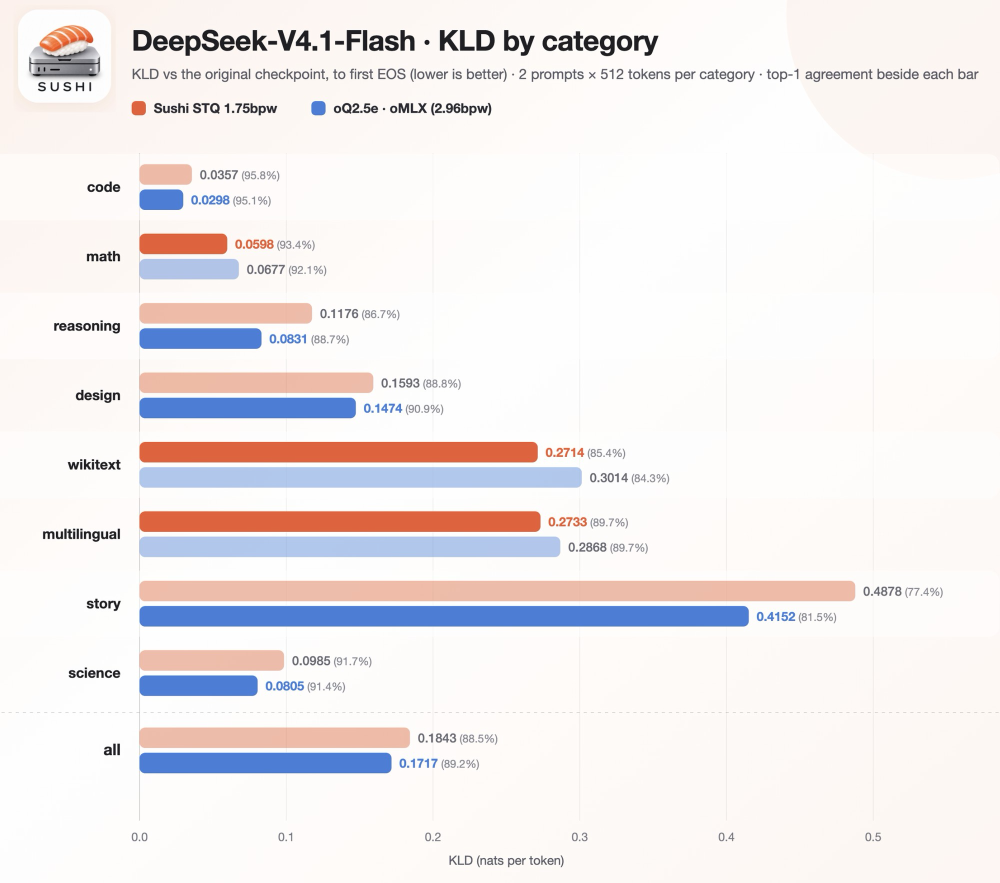

<p align="center"></p>

# SUSHI

A local AI server for low-bit, very high quality Sushi quants, using custom EXL3-Affine hybrid converter. It is a detached fork of [ddalcu's mlx-serve](https://github.com/ddalcu/mlx-serve). Sushi runs stand-alone and also as a guest engine inside mlx-serve, Apple Silicon M1+ and macOS 26.2 or later are required.

## Model support list

Usage see [recommended launch commands and coding agent usage](docs/usage.md).

* [DeepSeek-V4.1-Flash-1017-Sushi-STQ-1.75bpw](https://huggingface.co/beamster/DeepSeek-V4.1-Flash-1017-Sushi-STQ-1.75bpw) (requires 96 GB+ and sushi 1.4.0 or later, experts [streamed](#streaming), text and image input)
* [Qwen3.8-Flash-Next-Sushi-2bpw](https://huggingface.co/beamster/Qwen3.8-Flash-Next-Sushi-2bpw) (requires 48 GB+, or 32 GB [streamed](#streaming))
* [Qwen3.8-Flash-Next-Sushi-STQ-2.75bpw](https://huggingface.co/beamster/Qwen3.8-Flash-Next-Sushi-STQ-2.75bpw) (requires 64 GB+ and sushi 1.3.0 or later)
* [Qwen3.8-Flash-Next-Sushi-4bpw](https://huggingface.co/beamster/Qwen3.8-Flash-Next-Sushi-4bpw) (requires 96 GB+)
* [MiMo-V2.6-Flash-Sushi-2.3bpw](https://huggingface.co/beamster/MiMo-V2.6-Flash-Sushi-2.3bpw) (requires 128 GB, text and image input)
* [GLM-5.3-Flash-Sushi-2bpw](https://huggingface.co/beamster/GLM-5.3-Flash-Sushi-2bpw) (requires 96 GB+, text, image and video input)
* [GLM-5.3-Flash-Sushi-2.4bpw](https://huggingface.co/beamster/GLM-5.3-Flash-Sushi-2.4bpw) (requires 128 GB, text, image and video input)

## Quality

<p align="center"></p>

<p align="center"></p>

* MiMo-V2.6-Flash-Sushi-2.3bpw scores KLD 0.0860 (top-1 agreement 91.95%)
* GLM-5.3-Flash-Sushi-2.4bpw scores KLD 0.0742 (top-1 agreement 90.33%)
* GLM-5.3-Flash-Sushi-2bpw scores KLD 0.1037 (top-1 agreement 88.18%)

## Install

```bash
brew install beamivalice/tap/sushi
```

Update with `brew upgrade sushi`.

* The server listens on `127.0.0.1:12345`.
* Support speculative decoding: MTP for Qwen and MiMo, DFlash2 for GLM.
* 8-bit KV cache are on by default.

## Memory

GPU memory in GiB to serve one prompt that fills the whole context (8-bit KV, MTP on with `--mtp-head-kv-quant`; GLM
with its DFlash2 assistant and vision tower). The prompt cache and the n-gram table stay on the SSD and are not counted.
The Qwen rows are at the default f32 GatedDeltaNet state; `--qwen-gdn 16` (bf16) takes about 0.2 GiB off each Qwen cell.

| pack | weights only | 128k | 256k | 512k | 1M |
|---|---:|---:|---:|---:|---:|
| Qwen3.8-Flash-Next-Sushi-2bpw | 35.2 | 40.3 | 43.2 | 48.2 | 58.4 |
| Qwen3.8-Flash-Next-Sushi-STQ-2.75bpw | 46.4 | 51.4 | 54.3 | 59.4 | 69.5 |
| Qwen3.8-Flash-Next-Sushi-4bpw | 63.9 | 69.0 | 71.9 | 76.9 | 87.1 |
| GLM-5.3-Flash-Sushi-2bpw | 78.3 | 82.6 | 83.8 | 86.0 | 90.5 |
| GLM-5.3-Flash-Sushi-2.4bpw | 89.8 | 94.1 | 95.2 | 97.5 | 102.0 |
| MiMo-V2.6-Flash-Sushi-2.3bpw | 89.7 | 93.7 | 95.8 | 99.9 | 108.2 |
| DeepSeek-V4.1-Flash-1017-Sushi-STQ-1.75bpw ‡ | 108.0 | 110.0 | 110.3 | 111.0 | 112.5 |

A context fits when its number is below the GPU limit you set with `sudo sysctl iogpu.wired_limit_mb`. Max context is
the largest multiple of 8192 tokens that fits, at 8-bit / 4-bit KV, with 256 MiB spare and capped at 1M (GLM has no
4-bit KV):

| pack | 48 GB † (43,000 MB) | 64 GB † (59,000 MB) | 96 GB (90,000 MB) | 128 GB (120,000 MB) |
|---|---|---|---|---|
| Qwen3.8-Flash-Next-Sushi-2bpw | 200k / 304k | 976k / 1M | 1M / 1M | 1M / 1M |
| Qwen3.8-Flash-Next-Sushi-STQ-2.75bpw | — | 416k / 664k | 1M / 1M | 1M / 1M |
| Qwen3.8-Flash-Next-Sushi-4bpw | — | — | 1M / 1M | 1M / 1M |
| GLM-5.3-Flash-Sushi-2bpw | — | — | 696k / — | 1M / — |
| GLM-5.3-Flash-Sushi-2.4bpw | — | — | — | 1M / — |
| MiMo-V2.6-Flash-Sushi-2.3bpw | — | — | — | 1M / 1M |
| DeepSeek-V4.1-Flash-1017-Sushi-STQ-1.75bpw ‡ | — | — | 1M / — | 1M / — |

† At `--qwen-gdn 16` (bf16 GatedDeltaNet state), which the 32, 48 and 64 GB launch lines use. The f32 default gives
less: 192k / 288k at 48 GB, and 968k / 1M (Sushi-2bpw) and 408k / 648k (Sushi-STQ-2.75bpw) at 64 GB.

‡ DeepSeek-V4.1-Flash streams its routed experts from the SSD on every under 128GB Mac. It runs 1M at `--ssd-budget-gb 108` on a 128 GB Mac with `iogpu.wired_limit_mb=125000` and at `80` on a 96 GB Mac with `iogpu.wired_limit_mb=93000` ([usage](docs/usage.md#deepseek-launch)). A budget above 108 (for example 114) also needs `sudo sysctl vm.global_user_wire_limit=125000000000 vm.user_wire_limit=125000000000`: without it, prefill slows down with no error.

## Streaming

Any Sushi pack runs on a Mac with less memory than its weights. `--ssd-budget-gb N` keeps N GiB resident (the trunk,
the speculative head and a cache of routed experts) and reads the other experts from the SSD, with the same replies as
a resident load. A larger N caches more experts and reads the SSD less. The context's KV or state is billed on top, so
N plus the context must fit under the GPU limit.

| Mac | pack | `--ssd-budget-gb` | GPU limit (MB) | context | decode at 4k |
|---|---|---:|---:|---|---|
| 32 GB | Qwen3.8-Flash-Next-Sushi-2bpw | 18 | 27,000 | 66k | ~20 tok/s |
| 96 GB | DeepSeek-V4.1-Flash-1017-Sushi-STQ-1.75bpw | 80 | 93,000 | 1M | 45 code / 45 prose |
| 128 GB | DeepSeek-V4.1-Flash-1017-Sushi-STQ-1.75bpw | 108 (or 96) | 125,000 | 1M | 77 code / 49 prose |

## Benchmarks

### Sushi bench (Speed)

| Sushi 🍣 1.4.0 | M5 Max 128 GB | 4k | 8k | 16k | 32k | 64k | 128k |
|---|---|---:|---:|---:|---:|---:|---:|
| **Qwen 3.8 Flash-Next-STQ-2.75bpw** | Prefill | 1,122 | 1,993 | 2,049 | 1,976 | 1,906 | 1,877 |
| | Decode | 168.6 | 151.1 | 146.1 | 146.8 | 151.0 | 138.2 |
| **Qwen 3.8 Flash-Next-4bpw** | Prefill | 2,079 | 2,379 | 2,326 | 2,231 | 2,147 | 2,120 |
| | Decode | 146.2 | 150.1 | 136.2 | 149.8 | 153.5 | 122.0 |
| **GLM 5.3 Flash-2.4bpw** | Prefill | 928 | 775 | 814 | 805 | 688 | 573 |
| | Decode | 71.5 | 69.4 | 67.3 | 65.8 | 71.8 | 63.8 |
| **DeepSeek 4.1 Flash-STQ-1.75bpw** (`--ssd-budget-gb 108`) | Prefill | 707 | 1,024 | 998 | 993 | 950 | 829 |
| | Decode | 76.6 | 84.2 | 76.2 | 85.3 | 78.1 | 63.7 |

### Tool-eval-bench 3.0 (Agentic)

| Pack                 | Thinking | Score  | Points  | Rating | Max weights in RAM |
| -------------------- | -------- | ------ | ------- | ------ | ------------------ |
| DeepSeek STQ 1.75bpw | high     | **92** | 178/194 | 5★     | 129 GB (108 stream)|
| Qwen STQ 2.75bpw     | medium   | **91** | 176/194 | 5★     | 50 GB              |
| Qwen 4bpw            | medium   | **90** | 174/194 | 5★     | 68 GB              |
| GLM 2.4bpw           | high     | **90** | 175/194 | 5★     | 98 GB              |
| MiMo 2.3bpw          | on       | **89** | 172/194 | 4★     | 103 GB             |
| Qwen 2bpw            | medium   | **88** | 170/194 | 3★     | 38 GB              |

## License

MIT, for sushi and the mlx-serve code it forks ([LICENSE](LICENSE)); ported kernels and vendored code are listed in
[NOTICE](NOTICE). The Qwen packs follow the Qwen Community License and the MiMo pack Xiaomi's MIT license, stated on
each Hugging Face page.
